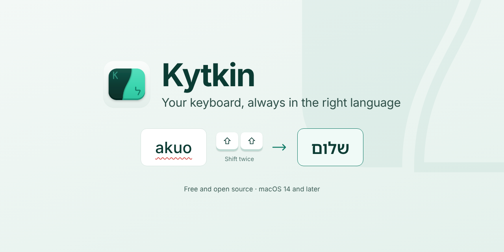
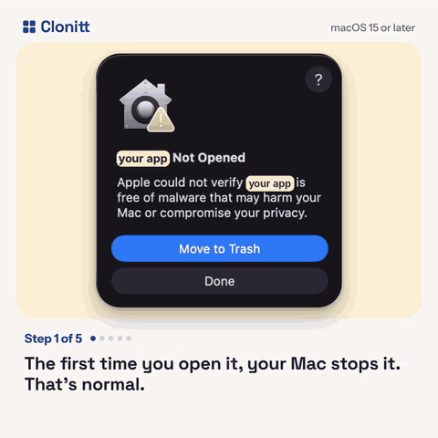

<p align="center">
  
</p>

# Kytkin

*Kytkin* (Finnish for **switch**, said "KUET-kin") is a small, free, open-source macOS menu-bar app. It flips your
keyboard language for you, like a light switch.

**[Download Kytkin for Mac](https://github.com/dishontomer5-coder/kytkin/releases/latest)**: get the file named
`Kytkin-<version>.dmg` under **Assets**, not "Source code". It needs macOS 14 Sonoma or later (tested on macOS 26),
on Apple silicon or Intel.

## What it does

- **Remembers your language per app and per website.** Switch to Hebrew once in WhatsApp, or on `ynet.co.il`, and
  Kytkin switches back to Hebrew every time you return there. Everywhere else it can keep your current language or use
  a default you choose. *Per-chat memory (a different language for each Slack or WhatsApp conversation) is planned for a
  later version.*
- **Fixes text typed in the wrong layout.** Typed `akuo` when you meant `שלום`? Press **Shift twice**. Kytkin converts
  your selection, or, with nothing selected, the text from the start of the text box up to the cursor (never what comes
  after it). It also switches the keyboard to the right language. Press Shift twice again to convert it back, or use
  the app's own ⌘Z.
- **Works in most apps.** Where Kytkin can read the text box directly (Notes, Mail, TextEdit, most web pages), it
  replaces the text in place. Elsewhere it goes through the clipboard and puts your clipboard back afterwards (see
  [Privacy](#privacy)). In **Slack, Discord and Teams** the converted text is pasted as plain text, so bold or italic in
  that message may be lost. In terminals, only what you typed since your last Return is converted, by retyping it.
- **Hebrew ⇄ English by default.** Your Mac's other keyboard layouts work too, and you can import layouts. Pick your
  two languages in Settings.

## Install

1. Open the downloaded `Kytkin-<version>.dmg` and **drag Kytkin into the Applications folder**. Don't open it from
   the disk image or from Downloads: macOS wouldn't keep its permissions there, and Kytkin will ask you to move it.
2. Eject the disk image, then open **Kytkin** from Applications.
3. macOS warns you the first time. Kytkin is free and isn't registered with Apple (that costs $99 a year), so macOS
   can't vouch for it. The code is all here on GitHub. To open it anyway:
   - **macOS 15 Sequoia and later:** the message says *"Kytkin" Not Opened*. Click **Done**, not Move to Trash. Open
     **System Settings → Privacy & Security** and scroll down to *"Kytkin" was blocked to protect your Mac*. Click
     **Open Anyway**, click **Open Anyway** again in the dialog, and enter your Mac password.
   - **macOS 14 Sonoma:** the message says Kytkin *can't be opened*. Click **OK**, then go to **System Settings →
     Privacy & Security** and click **Open Anyway** next to the Kytkin message. (Or Control-click Kytkin in
     Applications, choose **Open**, then **Open**.)

   

4. Kytkin's short setup asks for the permissions below and lets you try double-Shift in a practice box. Setup also
   turns on **Open Kytkin when I log in** by default: uncheck it there, or turn it off later in **Settings → General →
   Open at Login**.

## Updates

Setup offers **Keep Kytkin up to date** (off unless you tick it). You can change it any time in **Settings →
General → Updates**.

- When it is on, Kytkin checks GitHub once a day for a new version. If there is one, the menu shows **Update
  available: Kytkin x.y.z…**. Click it to see what's new, then click **Install Update**: Kytkin downloads the update,
  replaces itself and reopens. Nothing downloads or installs until you click. **Check Now…** checks right away.
- Nothing about you is sent: no system details, no IDs, nothing you type. GitHub sees only that a copy of Kytkin
  asked (its version number).
- Kytkin installs an update only if it comes from Kytkin's GitHub releases and is signed with the developer's update
  key (the list of updates is signed too). Every release is also signed with the same certificate as your copy, so
  your permissions carry over.
- Updates use [Sparkle](https://sparkle-project.org/), the open-source updater many Mac apps use.

**Updating by hand** (or from 1.0.0, which can't update itself): quit Kytkin (menu-bar icon → Quit Kytkin), drag
the new version into Applications and choose **Replace**, then do step 3 again. Your settings stay. If double-Shift
stops working after an update, open System Settings → Privacy & Security → Accessibility and turn Kytkin off and on
again.

## Permissions, and why

| Permission | Needed? | Why |
|---|---|---|
| **Accessibility** | Yes, for converting and website rules | Lets Kytkin read and replace the text you convert, notice a double-Shift, and see which website you're on. Without it Kytkin still switches the language per app. |
| **Input Monitoring** | Usually not | Only a backup, so Kytkin can notice a double-Shift when Accessibility is off. Settings shows "Not needed" when Accessibility covers it. |
| **Automation** (per browser) | Optional, off unless you turn it on | Settings → Websites → "Ask the browser for the page address (Automation)". Kytkin then asks a browser for the current tab's address, and whether the window is private, when it can't read them through Accessibility. macOS asks you once for each browser. |

Kytkin explains each permission before macOS asks for it. You can change them any time in **System Settings →
Privacy & Security**.

## Privacy

- **Nothing you type is logged, saved or sent.** Kytkin keeps only what you typed since your last Return, click or
  switch to another window, in memory, for a short time (it is forgotten after 3 minutes without typing), so it can
  be converted.
- **A double-Shift reads only what it converts:** the selection, or the text box up to the cursor. It also reads the
  names of mentions and links in the box, so they stay unconverted. All of it is dropped right after that one
  conversion.
- **The clipboard:** in apps whose text box Kytkin can't read, it copies the text, pastes it back converted, and then
  puts back exactly what you had copied. It never does this in terminals, in password boxes, or while you have a
  password copied. What Kytkin pastes is marked so clipboard history apps skip it. **But** the copy the app itself
  makes is not marked, so **clipboard history apps (like Maccy, Raycast or Alfred) may briefly see the copied text and
  save it.** If you use one, you can turn this off in Settings → Double-Shift → "Convert through the clipboard when
  needed".
- **Website addresses:** to pick a website's language, Kytkin reduces the page address to its domain (`ynet.co.il`) at
  once and drops the rest. To protect whole-document sites (like Google Docs), a double-Shift may check whether the page
  is an ordinary page, a webmail page or a document, and drops the address at once. Private windows are never learned
  from.
- **What is saved** (in `~/Library/Application Support/Kytkin/`): only your settings, the language for each app (by its
  ID), for each website domain (or an exact subdomain you add yourself), and any keyboard layouts you import. Never
  text, clipboard contents, page addresses or window titles.
- **No analytics, no telemetry, no account.** The only network use is optional updates, **off unless you turn them
  on** (setup, or Settings → General → Updates): checking GitHub once a day for a newer Kytkin and, when you click
  Install, downloading and installing a signed Kytkin update. Nothing about you or your typing is sent. See
  [Updates](#updates).

## Uninstall

1. Quit Kytkin (menu-bar icon → **Quit Kytkin**).
2. If Kytkin opens at login: **System Settings → General → Login Items**, select Kytkin and click **−**.
3. Drag **Kytkin** from Applications to the Trash.
4. Remove its permissions: **System Settings → Privacy & Security → Accessibility**, select Kytkin and click **−**.
   Do the same under **Input Monitoring** and **Automation** if Kytkin is listed there. Or run this in Terminal to do
   all of them at once:
   ```sh
   tccutil reset All io.github.kytkin.Kytkin
   ```
5. Delete its settings: in Finder choose **Go → Go to Folder…**, enter `~/Library/Application Support/`, and delete
   the **Kytkin** folder. If `~/Library/Preferences/io.github.kytkin.Kytkin.plist` exists, you can delete it too (it
   holds only window positions macOS keeps for the app, and the updater's settings, like when it last checked).

## Build from source

You need macOS 14 or later, [Xcode](https://apps.apple.com/app/xcode/id497799835) (the full app, not only the
Command Line Tools) and [XcodeGen](https://github.com/yonaskolb/XcodeGen) (`brew install xcodegen`).

```sh
./scripts/build.sh          # Debug build: build/Build/Products/Debug/Kytkin Dev.app
./scripts/build.sh test     # source lints + unit tests
./scripts/package-dmg       # Release build + build/Kytkin-<version>.dmg and its SHA-256
./scripts/make-appcast      # (releases) sign the DMG for Sparkle and write build/appcast.xml
```

The Debug app is called **Kytkin Dev** and has its own bundle ID and settings folder, so it never mixes with an
installed Kytkin. The Xcode project is generated from `project.yml`. Edit that file, not the `.xcodeproj`.

## Releasing

For the maintainer. Every installed copy checks the EdDSA signatures made with the maintainer's Sparkle key, on the
appcast and on the DMG; that key is what it trusts. Sparkle does not compare certificates once that signature passes,
so the scripts do: `make-appcast` refuses a DMG whose app isn't signed with the "Kytkin Release" certificate (an
ad-hoc build would make every user grant Accessibility again).

**Once: the Sparkle update key.** The private half lives only in your login keychain, like the certificate.

1. Build once so Xcode downloads Sparkle and its tools: `./scripts/build.sh`.
2. In Terminal, from the repository folder:
   ```sh
   "$(find build/SourcePackages/artifacts -name generate_keys -path '*/bin/*' | head -1)"
   ```
   It creates the key in your keychain (macOS may ask for access: allow it) and prints a `SUPublicEDKey` value.
3. Paste that value into `Config/Info.plist`, replacing `REPLACE_WITH_SPARKLE_PUBLIC_ED_KEY`, and commit it (it is
   the public half; safe to publish).
4. Back up the private key next to the certificate backup:
   `generate_keys -x ~/somewhere-safe/kytkin-sparkle-private-key` (same tool, `-x` exports it). Keep it secret. If
   it is lost, installed copies can never update again by themselves.

**Every release:**

1. Raise `MARKETING_VERSION` **and** `CURRENT_PROJECT_VERSION` in `project.yml` (Sparkle compares the second), and
   add the version's section to `CHANGELOG.md` (it becomes the update window's notes).
2. `KYTKIN_RELEASE_SIGN_IDENTITY="Kytkin Release" ./scripts/package-dmg`
3. `./scripts/make-appcast` (signs the DMG with your Sparkle key, checks it matches the app's public key, writes
   `build/appcast.xml`).
4. Create the GitHub release `v<version>` and upload **both** `build/Kytkin-<version>.dmg` and `build/appcast.xml`.
   Installed copies read the appcast of the latest release.

## Developer and support

Made by Tomer Dishon.

Bug or question? [Open an issue on GitHub](https://github.com/dishontomer5-coder/kytkin/issues) or email
[dishontomer5@gmail.com](mailto:dishontomer5@gmail.com).

## Clean-room statement

Kytkin is an independent, clean-room implementation inspired by the idea of apps like FlicKey. It contains no code,
text, or assets from FlicKey. Contributors must not consult FlicKey's source repository when working on Kytkin.

## License and credits

Kytkin is released under the [MIT License](LICENSE).

Kytkin was built by Tomer Dishon for Ofir W. So she would never have to pay for a keyboard switcher again — and get
a better one.

It uses [Sparkle](https://sparkle-project.org/) (MIT License) for one-click updates, and bundles the
[Public Suffix List](https://publicsuffix.org/) (Mozilla Public License 2.0), unmodified, to find a
website's domain. See [THIRD_PARTY_NOTICES.md](THIRD_PARTY_NOTICES.md).
